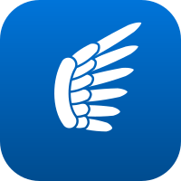

  

**[hermes.jaybulb.com](https://hermes.jaybulb.com)**

App Store Connect is a website built for one app at a time. Hermes is a Mac app built for all of them at once.

## Features

Every app in one list, with its icon, its live version on each platform and where it stands in review. Open one for versions, metadata, screenshots, builds, TestFlight, reviews, submissions, events, prices and purchases. Every change shows the exact command and asks first.

Hermes runs on the [asc](https://github.com/rorkai/App-Store-Connect-CLI) tool, so your API key stays on your Mac.

## Get it

[Download Hermes.dmg](https://github.com/nulljosh/hermes/releases/latest/download/Hermes.dmg), signed and notarized. Sign in to `asc` first.

## Agents

`mcp/server.py` is an MCP server, read-only unless `HERMES_ALLOW_WRITES=1`:

```sh
claude mcp add hermes -- uv run ~/Documents/Code/hermes/mcp/server.py
```

## Build

```sh
brew install xcodegen asc
xcodegen generate && open Hermes.xcodeproj
```

The roadmap is `docs/roadmap.md`. How it works is `docs/WHITEPAPER.md`.
